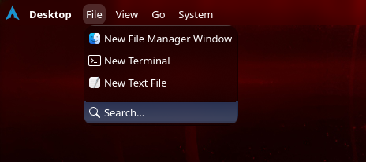
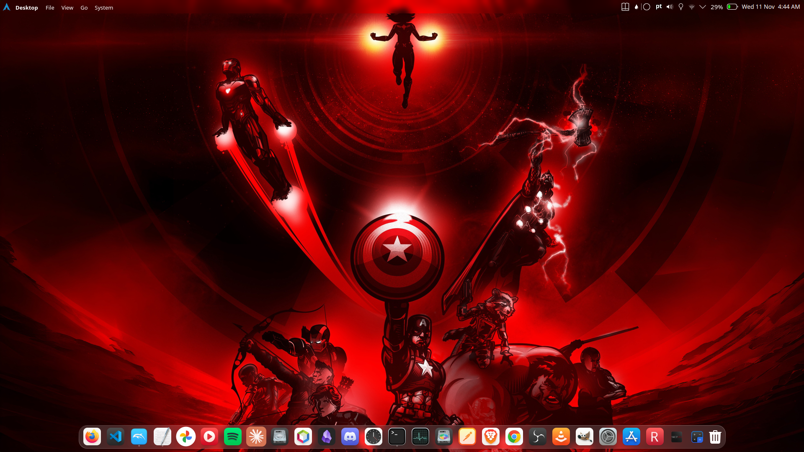

# Desktop Menu

[](https://github.com/sidneicjr28/plasma-desktop-menu/releases/latest)
[](LICENSE)
[](https://www.opendesktop.org/p/2381608/)


A Plasma 6 panel widget that brings a macOS Finder-style menu to the desktop. Place it next to the Global Menu: it appears only when no application window is focused, and hides as soon as an app takes focus.





## Menus

- **File** — new Dolphin window, new terminal (Konsole), new text file (KWrite)
- **View** — Overview, Show Desktop, take a screenshot (Spectacle), About
- **Go** — Home, Desktop, Documents, Downloads, Pictures, Computer, Trash
- **System** — System Settings, System Monitor, Lock, Log Out, Restart, Shut Down
- **Search** button (right side) — opens KRunner

## Requirements

Plasma 6. The default menu entries use Dolphin, Konsole, KWrite, Spectacle and Plasma System Monitor.

## Install

### From the Plasma widget browser

Right-click the panel → **Add Widgets…** → **Get New Widgets** → **Download New Plasma Widgets**, then search for **Desktop Menu**.

Or get it from the [KDE Store page](https://www.opendesktop.org/p/2381608/).

### From a GitHub release

Download the `.plasmoid` file from the [latest release](https://github.com/sidneicjr28/plasma-desktop-menu/releases/latest) and run:

```sh
kpackagetool6 -t Plasma/Applet -i desktop-menu-*.plasmoid
```

To update later, use `-u` instead of `-i`.

### From source

```sh
git clone https://github.com/sidneicjr28/plasma-desktop-menu.git
kpackagetool6 -t Plasma/Applet -i plasma-desktop-menu
```

After installing, add **Desktop Menu** to the panel that holds the Global Menu, right after it.

### Development

Symlink the repo so edits are picked up after `plasmashell --replace`:

```sh
ln -s "$PWD" ~/.local/share/plasma/plasmoids/io.github.sidneicjr28.desktopmenu
```

## Customizing

Edit the `menus` list in `contents/ui/main.qml`. Each entry is `[label, icon, shell command]`; `null` inserts a separator.

## License

GPL-2.0-or-later. See [LICENSE](LICENSE).
